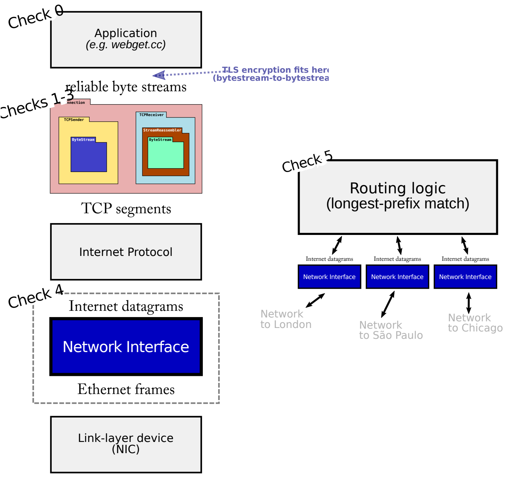

斯坦福 CS144 网络课程实验
==============================

本项目为 Stanford CS144 网络课程实验，该实验自顶向下实现了一个简单但功能完整的TCP/IP网络协议栈，涵盖传输层，网络层（和链路层的核心组件。总体架构图如下所示：

而**网络接口**则是负责在网络层（IP层）和链路层（以太网层）之间进行数据交换的组件，主要功能是将网络层的IP数据报（datagrams）封装为链路层的以太网帧（Ethernet frames），或者将从链路层接收到的以太网帧解封装为IP数据报。这个组件可以“位于”TCP/IP协议栈的“下方”，但它也会在另一个场景中使用：被实验6中实现的路由器用作数据交换的桥梁。下图展示了网络接口在这两种场景中的位置。

**路由器**包含多个网络接口，可以接收来自任意一个接口的 IP 数据报。路由器会将接收到的数据报转发到下一个跳点，并通过适当的出站接口发送。路由表告诉路由器如何做出这个决策。

Stanford CS 144 Networking Lab
==============================

These labs are open to the public under the (friendly) request that to
preserve their value as a teaching tool, solutions not be posted
publicly by anybody.

Website: https://cs144.stanford.edu

To set up the build system: `cmake -S . -B build`

To compile: `cmake --build build`

To run tests: `cmake --build build --target test`

To run speed benchmarks: `cmake --build build --target speed`

To run clang-tidy (which suggests improvements): `cmake --build build --target tidy`

To format code: `cmake --build build --target format`
