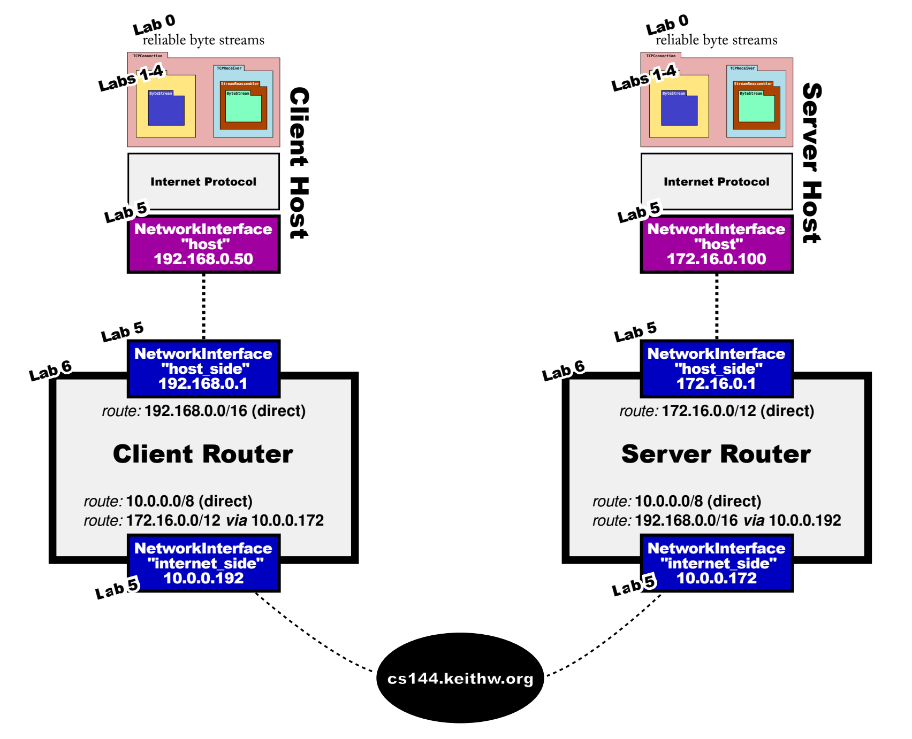

斯坦福 CS144 网络课程实验
==============================

本项目为 Stanford CS144 网络课程实验，实验自顶向下，从无到有的逐步构建了一个功能相对齐全的 TCP/IP 网络协议栈，实现了其中的一些核心组件，涵盖传输层，网络层和链路层的核心组件。主要包括：
+ `src/byte_stream*`：面向内存的可靠字节流，通过 FIFO 队列传输字节，是 TCP 程序与用户程序之间传输数据的载体，并实现了一系列的底层优化，经测试平均船速速率达到了 19.10 Gbit/s。
+ `src/reassembler*`：字节流重组器，负责在接收端重组来自发送端的 TCP 数据段，是实现可靠数据传输的根本保证，同时动态维护接收端窗口大小（以便后续实现拥塞控制），同样采用了高效的数据结构和灵活的设计，经测试平均吞吐率可以达到 10.31 Gbit/s。
+ `src/tcp_receiver*`：TCP 接收端，负责接收来自发送端的数据放入 reassembler，并发送回执消息（其中包含窗口大小，这是实现拥塞控制的关键要素），通过实现 `src/wrapping_integers*` 相关逻辑，成功减少了 TCP 头部中发送的数据大小，从而实现了更高的传输效率。
+ `src/tcp_sender*`：TCP 发送端，负责从字节流中接收来自用户程序的数据，将其分割成 TCP段后通过网络将其发送到接收端，在与接收端一同提供了可靠传输保证的同时，实现了超时重传和拥塞控制机制。
+ `src/network_interface*`：网络接口，负责在网络层和链路层之间进行数据交换，同时也作为路由器转发数据的桥梁，包括数据的封装（从 IP 数据报到链路帧）和解封装，并实现了 ARP 协议，用于进行地址映射的缓存和解析。
+ `src/router*`：简易路由器，实现了动态维护路由匹配规则和路由转发功能，使用 Trie 树高效地实现路由转发时的最长前缀匹配算法。

各部分组件在网络通信过程中的整体架构图如下所示：

对于网络接口和路由器的相关交互逻辑如下图所示：

实验代码均经过实验测试，并且可以替代 Linux 标准网络协议栈中的相关部分，在现实的网络通信中稳定运行。

**注：此仓库仅作暂时公开，任何正在参与此项课程的人应遵守诚信原则，不应抄袭他人的解决方案**。

课程网站: https://cs144.stanford.edu

设置构建系统: `cmake -S . -B build`

编译: `cmake --build build`

运行测试: `cmake --build build --target test`

运行性能基准测试: `cmake --build build --target speed`

运行clang-tidy: `cmake --build build --target tidy`

格式化代码: `cmake --build build --target format`
